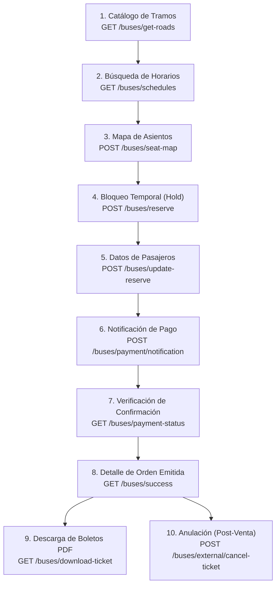

# Manual Técnico de Integración API REST — Chilepasajes / Enbus GDS

Este documento describe la especificación técnica oficial, la arquitectura y la secuencia de integración para interactuar con la API REST de Chilepasajes / Enbus (`https://back-qas.enbus.cl/docs`). Permite a desarrolladores e integradores implementar el ciclo de vida completo de venta, emisión, verificación y anulación de pasajes de bus interurbanos sobre el GDS.

---

## 1. Arquitectura General, Autenticación y Entornos

### 1.1 Entorno de Pruebas (QAS / Sandbox)
- **Base URL QAS**: `https://back-qas.enbus.cl/api/v1`
- **Documentación Interactiva (Scalar / OpenAPI)**: `https://back-qas.enbus.cl/docs`
- **Especificación OpenAPI (YAML)**: `https://back-qas.enbus.cl/docs/openapi.es.yaml`
- **Formato de Intercambio**: JSON (`application/json`, codificación UTF-8)

### 1.2 Autenticación y Encabezados HTTP
Todas las peticiones a la API REST requieren autenticación mediante API Key enviada en el encabezado `Authorization` con esquema `Bearer`:

```http
Authorization: Bearer sk_test_TU_API_KEY
Content-Type: application/json
Accept: application/json
```

> **Nota sobre notificaciones de pago**: La ruta pública `POST /buses/payment/notification` puede ser consumida sin el header `Authorization` cuando proviene de pasarelas o webhooks externos.

### 1.3 Estructura Estándar de Respuestas

#### Respuesta Exitosa (`200 OK` / `201 Created`):
```json
{
  "success": true,
  "response": {
    /* Objeto o Array con los datos del recurso */
  }
}
```

#### Respuesta de Error (`4xx` / `5xx`):
```json
{
  "success": false,
  "response": {
    "message": "Descripción legible del error",
    "error_code": 400,
    "details": "Detalle técnico o validación de campos",
    "error_key": null
  }
}
```

### 1.4 Límites de Tráfico (Rate Limiting)
- **`reads`** (Catálogos y consultas de horarios): 60 peticiones/minuto por IP.
- **`flow`** (Reservas, emisiones y post-pago): 30 peticiones/minuto por IP.
- **Descargas de PDF** (`/buses/download-ticket`, `/buses/download-boarding-card`): Exentas del límite `flow` para facilitar descargas múltiples de boletos.

---

## 2. Diagrama del Flujo Completo de Compra y Post-Venta

El ciclo de transacción comprende las siguientes etapas secuenciales:



---

## 3. Especificación Detallada de Endpoints por Fase

### Fase 1: Catálogos de Rutas y Ciudades

#### 1.1 Obtener Tramos Habilitados
Devuelve las combinaciones válidas de origen y destino por empresa de bus.
- **Método**: `GET`
- **Ruta**: `/buses/get-roads`
- **Parámetros Query**:
  - `complement` (string, opcional, ej: `pasajes`)

##### Ejemplo de Respuesta (`200 OK`):
```json
{
  "success": true,
  "response": [
    {
      "company_id": 999,
      "company_name": "PRUEBAS",
      "origin_city": "Santiago",
      "destination_city": "Talca",
      "terminal_origin": "Terminal Sur, Santiago",
      "terminal_destination": "Terminal de Talca"
    }
  ]
}
```

#### 1.2 Obtener Ciudades
Lista de ciudades para búsqueda por nombre clave (`search_name`).
- **Método**: `GET`
- **Ruta**: `/buses/get-cities`
- **Parámetros Query**: `complement=pasajes`

##### Ejemplo de Respuesta (`200 OK`):
```json
{
  "success": true,
  "response": {
    "cities": [
      { "id": 100, "city": "Santiago, Chile", "search_name": "santiago", "selected": true },
      { "id": 200, "city": "Talca, Chile", "search_name": "talca", "selected": false }
    ]
  }
}
```

---

### Fase 2: Consulta de Horarios y Disponibilidad

#### 2.1 Obtener Horarios (Schedules)
Consulta las frecuencias y servicios disponibles para una ruta y fecha. Cada servicio incluye un `token` cifrado que identifica el itinerario y debe reutilizarse en los pasos siguientes.
- **Método**: `GET`
- **Ruta**: `/buses/schedules`
- **Parámetros Query**:
  - `city_or` (string, requerido): `search_name` del origen (ej: `santiago`).
  - `city_de` (string, requerido): `search_name` del destino (ej: `talca`).
  - `date_or` (string, requerido): Fecha de ida en formato `DD-MM-YYYY` o `YYYY-MM-DD`.
  - `date_reg` (string, opcional): Fecha de regreso para viajes ida y vuelta.
  - `complement` (string, opcional): `pasajes`.

##### Ejemplo de Respuesta (`200 OK`):
```json
{
  "success": true,
  "response": {
    "IDA": [
      {
        "id": 2750414,
        "token": "eJw1jlEOgCAMQ...==",
        "company_id": 999,
        "company_name": "PRUEBAS",
        "departure_date": "2026-11-12",
        "departure_time": "14:30",
        "arrival_date": "2026-11-12",
        "arrival_time": "18:00",
        "departure_city": "Santiago",
        "destination_city": "Talca",
        "terminal_origin": "Terminal Sur",
        "terminal_destination": "Terminal de Talca",
        "currency": "CLP",
        "is_transfer": false,
        "classes": [
          { "type": "SALON CAMA", "price": 9000, "available_seats": 18 },
          { "type": "SEMI CAMA", "price": 7000, "available_seats": 24 }
        ]
      }
    ]
  }
}
```

---

### Fase 3: Mapa de Asientos y Paraderos

#### 3.1 Obtener Asientos (Seat Map)
Devuelve la matriz de asientos por piso y los paraderos de subida y bajada.
- **Método**: `POST`
- **Ruta**: `/buses/seat-map`

##### Request Body:
```json
{
  "token": [
    "eJw1jlEOgCAMQ...=="
  ]
}
```

##### Ejemplo de Respuesta (`200 OK`):
```json
{
  "success": true,
  "response": {
    "IDA": {
      "limit_reserve": 5,
      "FLOORS": {
        "1": [
          {
            "seat": 1,
            "status": "0",
            "type": "SALON CAMA",
            "price": 9000,
            "idreserve": "eyJhbGciOi..."
          },
          {
            "seat": 2,
            "status": "1",
            "type": "SALON CAMA",
            "price": 9000,
            "idreserve": null
          }
        ]
      },
      "stops": {
        "subida": [
          { "id": 101, "name": "Terminal Sur, Santiago" }
        ],
        "bajada": [
          { "id": 201, "name": "Terminal de Talca" }
        ]
      }
    }
  }
}
```

> **Convención de `status` en asientos**:
> - `"0"`: Disponible para reservar (contiene `idreserve`).
> - `"1"`: Ocupado / No disponible.

---

### Fase 4: Reserva y Bloqueo Temporal (Hold)

#### 4.1 Reservar Asientos
Crea la orden temporal en el GDS y bloquea los asientos por un TTL de 15 minutos mientras se capturan los datos y se procesa el cobro.
- **Método**: `POST`
- **Ruta**: `/buses/reserve`

##### Request Body:
```json
{
  "session": "a1b2c3d4-e5f6-7890-abcd-ef1234567890",
  "complement": "pasajes",
  "device": "P",
  "reserves": [
    "eyJhbGciOi..."
  ]
}
```

##### Ejemplo de Respuesta (`200 OK`):
```json
{
  "success": true,
  "response": {
    "order": {
      "order_id": "d9bd038f-acc4-41cd-9644-1dfdc98c7166",
      "session": "a1b2c3d4-e5f6-7890-abcd-ef1234567890",
      "purchase_date": "2026-11-10T15:30:00-03:00",
      "total_purchase": 9000,
      "tickets": [
        {
          "ticket_id": "fe467741-3363-4550-a255-5929a50cf2e0",
          "order_id": "d9bd038f-acc4-41cd-9644-1dfdc98c7166",
          "price": 9000,
          "seat": 1,
          "seat_type": "SALON CAMA",
          "departure_date": "2026-11-12T14:30:00-03:00"
        }
      ]
    }
  }
}
```

---

### Fase 5: Actualización de Pasajeros y Comprador

#### 5.1 Actualizar Reserva (Update Reserve)
Asocia los datos del comprador y de cada pasajero a los `ticket_id` de la orden reservada.
- **Método**: `POST`
- **Ruta**: `/buses/update-reserve`

##### Request Body:
```json
{
  "client": {
    "order_id": "d9bd038f-acc4-41cd-9644-1dfdc98c7166",
    "session_id": "a1b2c3d4-e5f6-7890-abcd-ef1234567890",
    "cod_phone": "+56",
    "phone": "912345678",
    "email": "comprador@ejemplo.cl",
    "payment_method": "WEBPAY",
    "lang": "es"
  },
  "reserves": [
    {
      "ticket_id": "fe467741-3363-4550-a255-5929a50cf2e0",
      "document": "164829103",
      "document_type": "RUT",
      "first_name": "Juan",
      "last_name": "Pérez",
      "country": "CL",
      "birth_date": "1992-05-14",
      "cod_phone": "+56",
      "phone": "912345678",
      "stops": "Terminal Sur, Santiago",
      "downs": "Terminal de Talca"
    }
  ],
  "products": [],
  "frecuent_client_code": 0
}
```

##### Ejemplo de Respuesta (`200 OK`):
```json
{
  "success": true,
  "response": {
    "message": "Reserva actualizada con éxito"
  }
}
```

---

### Fase 6: Notificación de Pago

#### 6.1 Notificar Pago
Informa al GDS que la transacción fue pagada exitosamente para que el backend proceda con la emisión definitiva ante la empresa operadora del bus.
- **Método**: `POST`
- **Ruta**: `/buses/payment/notification`

##### Request Body:
```json
{
  "status": "paid",
  "merchant_order_id": "d9bd038f-acc4-41cd-9644-1dfdc98c7166",
  "order_id": "PAY-SIM-7839210",
  "paid_amount": 9000,
  "paid_currency": "CLP",
  "payment_method": "SIMULACION"
}
```

##### Ejemplo de Respuesta (`200 OK`):
```json
{
  "success": true,
  "response": {
    "message": "Notificación de pago procesada."
  }
}
```

---

### Fase 7: Verificación de Estado (Payment Status)

#### 7.1 Obtener Status de la Orden
Verifica si el cobro fue asentado (`is_paid: true`) y si la empresa de buses emitió los boletos (`is_confirmed: true`). Este paso es fundamental para confirmar la emisión antes de descargar los PDFs o dar por concluido el proceso.
- **Método**: `GET`
- **Ruta**: `/buses/payment-status`
- **Parámetros Query**:
  - `order_id` (UUID, requerido): UUID de la orden.

##### Ejemplo de Respuesta (`200 OK`):
```json
{
  "success": true,
  "response": {
    "order_id": "d9bd038f-acc4-41cd-9644-1dfdc98c7166",
    "external_order_id": "0091F6E5",
    "is_paid": true,
    "is_confirmed": true,
    "should_poll": true
  }
}
```

> **Estrategia de Polling**: Se recomienda realizar hasta 4 o 5 intentos con intervalos de 1 segundo hasta que `is_confirmed` retorne `true`.

---

### Fase 8: Obtención de Orden Confirmada y Boletos

#### 8.1 Consultar Orden Pagada (Success)
Devuelve el detalle final de la orden confirmada, boletos oficiales, políticas de anulación (`cancelable`) y cambio de paraderos (`change_stop`).
- **Método**: `GET`
- **Ruta**: `/buses/success`
- **Parámetros Query**:
  - `order_id` (string, requerido): `order_id` (UUID o código externo, ej: `0091F6E5`).

##### Ejemplo de Respuesta (`200 OK`):
```json
{
  "success": true,
  "response": {
    "order_id": "0091F6E5",
    "amount": "$ 9.000",
    "currency": "CLP",
    "tax": "$ 0",
    "payment_status": "PAGADO",
    "tickets": [
      {
        "ticket_id": "01D1S9VC",
        "order_id": "0091F6E5",
        "company_name": "PRUEBAS",
        "departure_city": "Santiago",
        "destination_city": "Talca",
        "seat": 1,
        "seat_type": "SALON CAMA",
        "stops": "Terminal Sur, Santiago",
        "downs": "Terminal de Talca",
        "departure_date": "2026-11-12T14:30:00-03:00",
        "arrives_date": "2026-11-12T18:00:00-03:00",
        "cancelable": true,
        "changeable": false,
        "change_stop": false
      }
    ]
  }
}
```

---

### Fase 9: Descarga de E-Tickets y Tarjetas de Embarque (PDF)

#### 9.1 Descargar Boleto Electrónico (PDF)
Descarga el PDF binario oficial del pasaje generado por la empresa de buses. Requiere que la orden esté previamente confirmada (`is_confirmed: true`).
- **Método**: `GET`
- **Ruta**: `/buses/download-ticket`
- **Parámetros Query**:
  - `order_id`: UUID o código externo de la orden.
  - `ticket_id`: Identificador externo del boleto (ej: `01D1S9VC`).
- **Respuesta**: Archivo binario con `Content-Type: application/pdf`.

#### 9.2 Descargar Tarjeta de Embarque (PDF)
Descarga la tarjeta de embarque oficial en formato PDF.
- **Método**: `GET`
- **Ruta**: `/buses/download-boarding-card`
- **Parámetros Query**:
  - `order_id`: UUID o código externo de la orden.
  - `ticket_id`: Identificador externo del boleto.
- **Respuesta**: Archivo binario con `Content-Type: application/pdf`.

---

### Fase 10: Anulación de Boletos (Post-Venta para Sellers Externos)

#### 10.1 Anular Boleto Externo
Permite a integradores y sellers externos anular de manera inmediata y definitiva un boleto pagado en los servidores de Chilepasajes y en la empresa de transporte.
- **Método**: `POST`
- **Ruta**: `/buses/external/cancel-ticket`
- **Permiso Requerido**: La cuenta / API Key debe tener activado el permiso `available_cancel` en el backend de Enbus.

##### Request Body:
```json
{
  "order_id": "0091F6E5",
  "ticket_id": "01D1S9VC"
}
```

##### Ejemplo de Respuesta Exitosa (`200 OK`):
```json
{
  "success": true,
  "response": {
    "success": true,
    "message": "Anulación realizada.",
    "order_id": "0091F6E5",
    "ticket_id": "01D1S9VC"
  }
}
```

##### Respuestas de Error Comunes:
- `400 Bad Request`: `"Este pasaje no es posible anularlo, la hora de salida del servicio se encuentra expirada"` o `"El boleto ya se encuentra anulado"`.
- `403 Forbidden`: `"No tienes permisos para anular tickets"` (solicitar habilitación de `available_cancel` al equipo de soporte de Enbus).
- `404 Not Found`: `"Boleto no encontrado"`.

---

## 4. Guía de Códigos HTTP y Manejo de Errores

| Código HTTP | Estado API | Significado y Acción Recomendada |
| :--- | :--- | :--- |
| `200 OK` / `201 Created` | Éxito | Operación ejecutada y confirmada en el GDS. |
| `400 Bad Request` | Parámetros Inválidos | Asiento ya bloqueado por otro usuario, campos faltantes o servicio expirado para anulación. |
| `401 Unauthorized` | No Autorizado | API Key ausente, malformada o caducada en el encabezado `Authorization: Bearer <KEY>`. |
| `403 Forbidden` | Sin Permisos | La cuenta carece de permisos para la operación (ej. `available_cancel` en anulaciones). |
| `404 Not Found` | No Encontrado | El `order_id`, `ticket_id` o servicio especificado no existe en la base de datos. |
| `422 Unprocessable` | Error de Validación | El formato del parámetro no cumple con el esquema (ej. `order_id` no es un UUID válido). |
| `429 Too Many Requests`| Rate Limit Excedido | Se superó el límite de peticiones por minuto (`reads` o `flow`). Implementar retroceso exponencial. |
| `500 Internal Error`| Error del Servidor | Falla de conexión o sincronización interna entre Enbus y el operador de buses. |
